# Ultra-Low-g<sub>m</sub> OTAs for a Tunable 50/60 Hz OTA-C Notch Filter — SkyWater 130 nm

A controlled comparison of three ultra-low-transconductance OTA styles (**current cancellation**, **bulk-driven** and **current division**) inside one common, bias-tunable 50/60 Hz power-line notch filter. All three are designed to the same specification in the open-source **SkyWater SKY130** process at ±0.9 V, laid out, verified with DRC and LVS, and re-simulated after parasitic extraction.

The whole flow uses open-source tools only: **Xschem → ngspice → Magic → Netgen**.

<p align="center">
  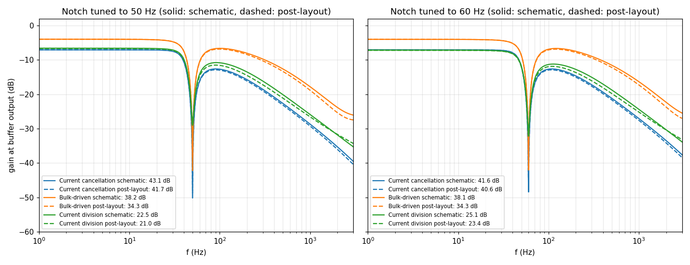
</p>

---

## Contents

- [Abstract](#abstract)
- [Motivation](#motivation)
- [Highlights](#highlights)
- [Filter architecture](#filter-architecture)
- [Design equations](#design-equations)
- [The three OTAs](#the-three-otas)
- [Physical design](#physical-design)
- [Verification method](#verification-method)
- [Results](#results)
- [Comparison with earlier work](#comparison-with-earlier-work)
- [Design lessons](#design-lessons)
- [Repository layout](#repository-layout)
- [Reproducing the results](#reproducing-the-results)
- [References](#references)

---

## Abstract

Power-line interference at 50/60 Hz corrupts biopotential and sensor signals. Rejecting it on chip needs transconductors of only about **1 nA/V**. This project compares three ultra-low-g<sub>m</sub> OTA styles (current cancellation, bulk-driven and current division) inside one third-order elliptic OTA-C notch filter. All three are designed to the same specification in SkyWater 130 nm CMOS at ±0.9 V.

Each OTA is sized with a weak-inversion g<sub>m</sub>/I<sub>D</sub> procedure and tuned from 50 to 60 Hz by its bias current alone. Each is then laid out (DRC and LVS clean) and re-verified after parasitic extraction with 100-run Monte Carlo mismatch, process and temperature corners, harmonic distortion, noise and transient tests.

| | Current cancellation | Bulk-driven | Current division |
|---|---|---|---|
| Notch depth at 50 Hz, schematic / post-layout | **43.1 / 41.7 dB** | 38.2 / 34.3 dB | 22.5 / 21.0 dB |
| THD at 5 mV | **0.18%** | 0.81% | 0.69% |
| Filter power | **2.3 nW** | 4.1 nW | 12.3 nW |
| Post-layout Monte Carlo yield | 94% | **100%** | 33% |
| Linear range | ±25 mV | **±95 mV** | ±32 mV |
| OTA area | 4019 µm² | **2471 µm²** | 6960 µm² |

- **Current cancellation** gives the deepest notch, the lowest distortion and the lowest power.
- **Bulk-driven** gives up some notch depth in exchange for a 4× wider linear range, the smallest area and the highest yield.
- **Current division** is not recommended at these currents: its division ratio uses up both the gain and the mismatch budget.

Across all three designs, **notch depth follows the OTA's open-loop gain**. Bias currents of **0.09–0.41 nA** retune every filter between 50 and 60 Hz.

---

## Motivation

ECG, EEG and EMG share their frequency band with 50/60 Hz mains pickup, which can be orders of magnitude larger than the signal. An analog notch placed before the ADC relaxes the dynamic range the ADC needs, so it is a standard block in wearable and implantable front-ends.

The difficulty is the time constant. An OTA-C integrator has a unity-gain frequency of g<sub>m</sub>/C, so a pole near 50 Hz with a few picofarads of on-chip capacitance needs g<sub>m</sub> ≈ 1 nA/V. That is about 1000× lower than a conventional OTA.

Earlier notch filters each used one g<sub>m</sub>-reduction technique, each in a different predictive technology (22, 32 and 180 nm) and with a different filter order, and none went beyond schematic simulation. This project holds everything except the OTA constant, so that every difference in the results comes from the OTA alone.

---

## Highlights

- **One specification for all three OTAs:** the same filter topology, capacitor set, output buffer and process.
- **Closed-form g<sub>m</sub>/I<sub>D</sub> sizing** for each OTA style.
- **Full physical design:** Magic layout, DRC = 0, Netgen LVS "Circuits match uniquely", and parasitic extraction (PEX).
- **Post-layout verification:** 100-run Monte Carlo, 8 process/temperature corners, THD, noise and transient tests.
- **Stability analysis** showing why the equal-element sixth-order canonical notch oscillates.
- **Fully reproducible:** SKY130 PDK, Xschem, ngspice, Magic and Netgen.

---

## Filter architecture

The filter is a third-order elliptic OTA-C ladder built from five identical OTAs and four MiM capacitors:

- **OTA4 and OTA5** are connected in unity feedback. They act as the source and load terminations (1/g<sub>m</sub>).
- **OTA2, OTA3 and C<sub>L2</sub>** form a gyrator that emulates a grounded inductor at node v<sub>x</sub>.
- **C<sub>2</sub>** (between v<sub>1</sub> and v<sub>o</sub>) resonates with that inductor to create the transmission zero.
- **One diode-connected PMOS and one current I<sub>b</sub>** bias all five OTAs, so a single current tunes the filter.

<p align="center">
  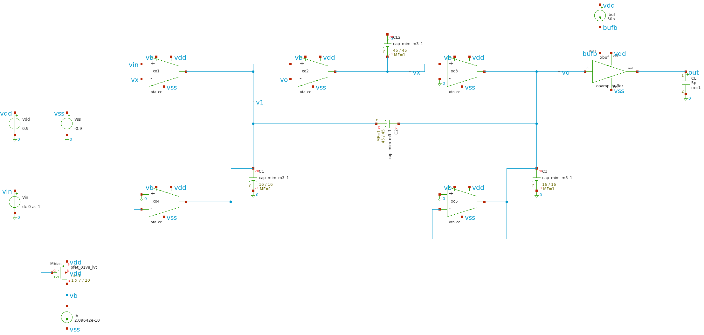
  <br><em>Notch filter testbench in Xschem, shown with the current-cancellation OTA.</em>
</p>

| Component | Value |
|---|---|
| C<sub>2</sub>, C<sub>L2</sub> | 4.08 pF (45 × 45 µm MiM) |
| C<sub>1</sub>, C<sub>3</sub> | 0.52 pF (16 × 16 µm MiM) |
| Total capacitor area | 0.0046 mm² |
| Required g<sub>m</sub> | 1.28 nA/V (50 Hz), 1.54 nA/V (60 Hz) |
| Supply | ±0.9 V |
| Output buffer | Rail-to-rail class-AB unity gain, 50 nA bias, 1.57 µW, 5 pF load (for measurement only) |

<p align="center">
  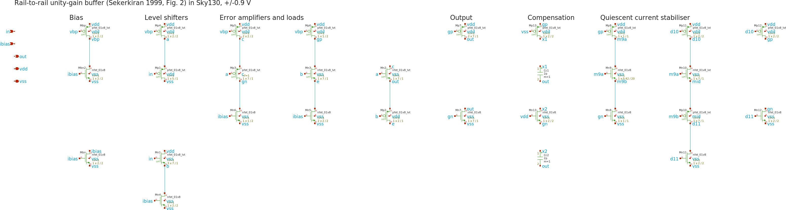
  <br><em>Rail-to-rail class-AB output buffer.</em>
</p>

---

## Design equations

### Inductor emulation and notch frequency

The gyrator turns C<sub>L2</sub> into an equivalent inductance:

$$L_{eq} = \frac{C_{L2}}{g_m^2}$$

This resonates with C<sub>2</sub> to set the notch frequency:

$$\omega_0 = \frac{1}{\sqrt{L_{eq}\,C_2}} = \frac{g_m}{\sqrt{C_2\,C_{L2}}}$$

With equal terminations, the ideal pass-band gain is H(0) = 1/2 (−6 dB).

### Tuning law

In weak inversion g<sub>m</sub> = I<sub>D</sub>/(nU<sub>T</sub>), so the notch frequency is proportional to the bias current:

$$f_0 = \frac{I_D}{2\pi\, n U_T \sqrt{C_2\,C_{L2}}}$$

Moving from 50 Hz to 60 Hz needs only a **21–24% increase in bias current** in every OTA style.

### Why not a sixth-order canonical filter?

Single-current tuning forces every integrator to have the same g<sub>m</sub>/C = ω. The characteristic polynomial of the sixth-order canonical notch then becomes:

$$D(s) = \sum_{k=0}^{6} s^k\,\omega^{6-k} = \frac{s^7 - \omega^7}{s - \omega}$$

Its roots are ωe<sup>j2πk/7</sup> for k = 1…6. The pair at k = 1 and k = 6 lies at ±51.4°, which is in the **right half-plane**. The equal-element filter therefore oscillates in transient simulation, even though its small-signal magnitude plot looks reasonable.

The third-order ladder inherits the unconditional stability of its passive LC prototype, so it was used for all three OTAs.

### OTA transconductance

| OTA style | g<sub>m</sub> |
|---|---|
| Current cancellation | $g_m = \dfrac{N-1}{N+1}\cdot\dfrac{I_B}{2}\cdot\dfrac{g_m}{I_D}$ |
| Bulk-driven | $g_m = \eta\,\dfrac{I_B/2}{nU_T}, \quad \eta = \dfrac{n-1}{n} \approx 0.3$ |
| Current division | $g_m = \dfrac{N_A-1}{N_A+1+N_C}\,g_R$ |

For the current-division OTA, the output-branch current needed for a given g<sub>m</sub> is:

$$I_{out} \approx \frac{4\,g_m\,(N_A+1)}{(N_A-1)\,(g_m/I_D)}$$

This current is **independent of N<sub>C</sub>**. That observation drove the redesign iterations described below.

### Mismatch

Threshold mismatch (Pelgrom) dominates at these currents, so all devices use long channels (L = 4–20 µm):

$$\sigma(\Delta V_T) = \frac{A_{VT}}{\sqrt{WL}}$$

---

## The three OTAs

All three OTAs run in weak inversion from ±0.9 V. The input devices are low-V<sub>T</sub> PMOS (`pfet_01v8_lvt`), and each tail current mirrors the shared bias diode 1:1.

### Current cancellation (N = 3) and bulk-driven

<p align="center">
  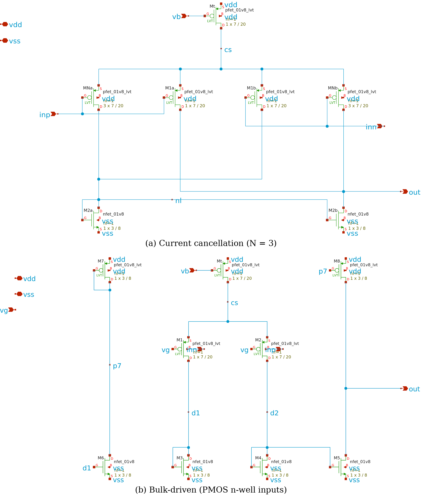
</p>

**Current cancellation:**

- Each input drives a unit transistor and a 3× transistor, whose drains go to opposite outputs, so most of the signal current cancels.
- The reduction factor is 1/2, so 50 Hz needs I<sub>B</sub> = 0.210 nA.
- The same factor multiplies the relative offset by (N+1)/(N−1), so the input devices are large (7/20 µm).
- **Redesign:** the first version used a larger NMOS mirror. Its gate capacitance added phase at 50 Hz and limited the notch to 18.6 dB. Shrinking the mirror to 3/8 µm raised the notch to 43 dB.

**Bulk-driven:**

- The PMOS pair is driven through its n-wells, while the gates are held at v<sub>g</sub> by a replica transistor.
- With η ≈ 0.3, the 50 Hz bias is 0.338 nA.
- The small η also scales down the non-linear terms, which gives this style the widest linear range of the three.

### Current division (N<sub>C</sub> : 1 : N<sub>A</sub> = 2 : 1 : 6)

<p align="center">
  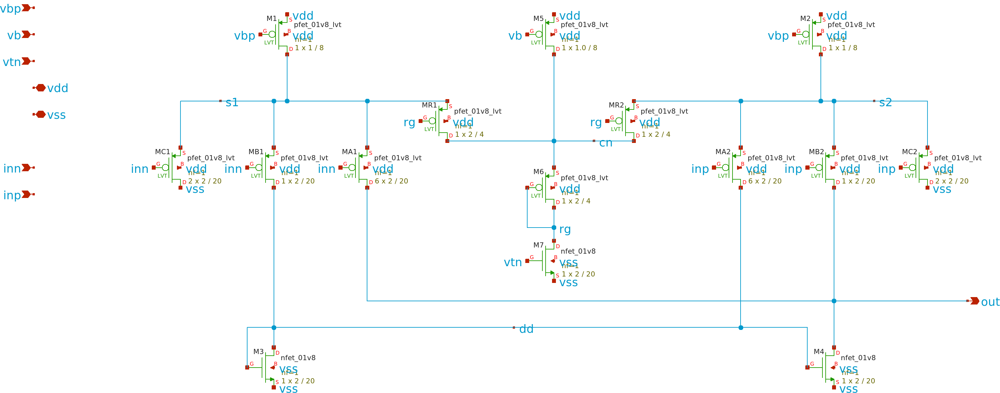
</p>

How it works:

- Each input drives three source followers in the ratio N<sub>C</sub> : 1 : N<sub>A</sub>.
- Triode transistors MR1 and MR2, whose conductance g<sub>R</sub> is set by the tuning current, convert the source voltages to current.
- N<sub>C</sub> units dump current to the rail; N<sub>A</sub> units carry it to the output.

The design went through two redesign iterations:

1. With N<sub>C</sub> = 6, the achievable g<sub>m</sub> saturated and f<sub>0</sub> could not exceed 47 Hz.
2. With N<sub>A</sub> = 2, the open-loop gain was only 23 dB and the notch only 16 dB.

The final design uses N<sub>A</sub> = 6, N<sub>C</sub> = 2 and 0.5 nA per side, and is tuned by 0.090 nA at 50 Hz.

### Final device sizes

| OTA | Devices | W/L (µm) × m | I<sub>B</sub> 50 / 60 Hz (nA) |
|---|---|---|---|
| Current cancellation | Mt, Mbias (tail) | 7/20 | 0.210 / 0.253 |
| | MNa, MNb / M1a, M1b | 7/20 × 3 / × 1 | |
| | M2a, M2b (NMOS) | 3/8 | |
| Bulk-driven | Mt, M1, M2, Mrep | 7/20 | 0.338 / 0.413 |
| | M3–M6 (NMOS), M7, M8 | 3/8 | |
| Current division | MA × 6, MB × 1, MC × 2 | 2/20 | 0.090 / 0.111 |
| | MR1, MR2, M6 / M1, M2 | 2/4 / 1/8 | |
| | M3, M4, M7 (NMOS) | 2/20 | I<sub>1</sub> = 1 (fixed) |

---

## Physical design

Each OTA was laid out in Magic from a Tcl script. The script places the transistors in rows inside a shared n-well, routes them in met1, and adds substrate and well taps.

<p align="center">
  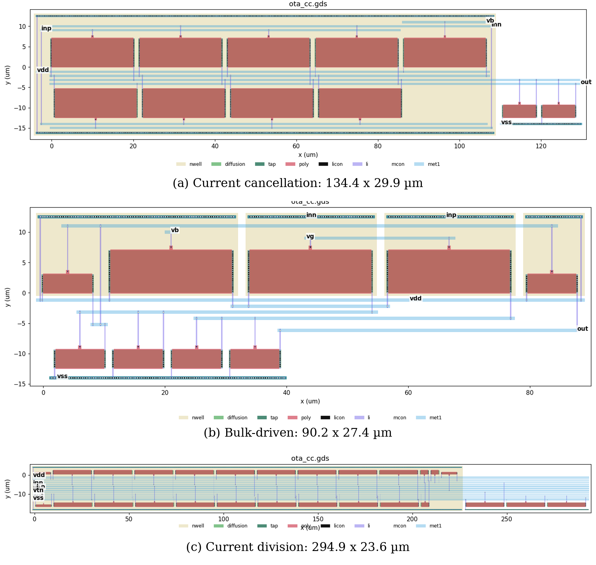
</p>

| OTA | Size (µm) | Area (µm²) | DRC | LVS (Netgen) | Parasitic capacitors extracted |
|---|---|---|---|---|---|
| Current cancellation | 134.4 × 29.9 | 4019 | 0 errors | Circuits match uniquely | 27 |
| Bulk-driven | 90.2 × 27.4 | 2471 | 0 errors | Circuits match uniquely | 52 |
| Current division | 294.9 × 23.6 | 6960 | 0 errors | Circuits match uniquely | 78 |

Every post-layout result in this README uses the extracted netlists (`layout/*_pex.spice`) in place of the schematic OTAs.

---

## Verification method

- **Simulator:** ngspice with the SkyWater BSIM4 models. The default gmin of 1 pS would inject a current comparable to the signal, so it is set to **10⁻¹⁶ S**.
- **Monte Carlo:** 100 runs using the PDK mismatch statistics, at both schematic and post-layout level.
  - A run counts toward the yield only if it shows a notch between 20 and 200 Hz that is at least 20 dB deep, and its 10 Hz gain is within 6 dB of nominal.
- **Corners:** tt, ss, ff, sf and fs at 27 °C, plus tt at 0, 37 and 85 °C. The bias is held fixed at its nominal 50 Hz value.
- **Distortion:** THD of a 10 Hz sine at 5, 10 and 20 mV peak.
- **Noise:** input-referred, integrated from 0.05 to 300 Hz.
- **Transient:** step settling time, overshoot, slew rate and group delay.

---

## Results

### Stand-alone OTA characteristics

| Parameter | Current cancellation | Bulk-driven | Current division |
|---|---|---|---|
| g<sub>m</sub> (nA/V) | 1.53 | 1.28 | 1.51 |
| Open-loop gain A<sub>0</sub> (dB) | **37.7** | 32.3 | 25.5 |
| CMRR (dB) | 55.9 | **72.3** | 46.2 |
| Linear range, g<sub>m</sub> within ±10% (mV) | −23 to +25 | **−96 to +95** | −31 to +33 |
| Input offset (mV) | **7.6** | 18.1 | 26.1 |
| Input noise, 0.05–300 Hz (µV<sub>rms</sub>) | **150** | 332 | 334 |
| Layout area (µm²) | 4019 | **2471** | 6960 |

<p align="center">
  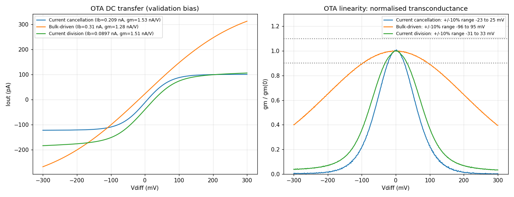
  <br><em>OTA output current versus differential input (left) and normalised g<sub>m</sub> (right). Dotted lines mark the ±10% limits.</em>
</p>

### Notch response and tuning

All notches land within 0.04 Hz of their target. Notch depth follows the open-loop gain: the finite output resistance of the gyrator OTAs adds loss to the emulated inductor, which lowers its Q and fills in the notch.

<p align="center">
  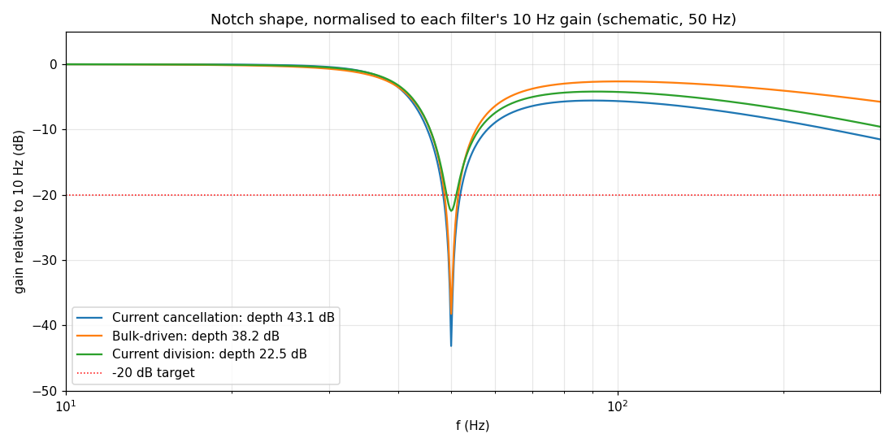
</p>

### Monte Carlo mismatch (100 runs)

<p align="center">
  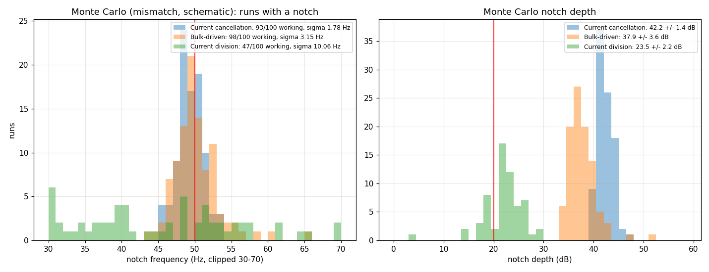
  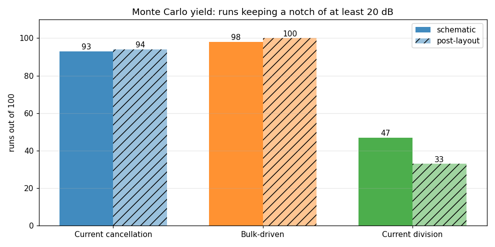
</p>

| Monte Carlo result, schematic / post-layout | Current cancellation | Bulk-driven | Current division |
|---|---|---|---|
| Yield (%) | 93 / 94 | **98 / 100** | 47 / 33 |
| σ(f<sub>0</sub>) (Hz) | **1.78 / 1.95** | 3.15 / 2.38 | 10.1 / 7.4 |
| Notch depth, mean ± σ (dB) | **42.2 ± 1.4 / 41.1 ± 1.5** | 37.9 ± 3.6 / 34.1 ± 1.6 | 23.5 ± 2.2 / 22.5 ± 1.6 |

The current-division filter fails in more than half of the runs. Its dumped-current mismatch is not divided down by the same ratio as the signal.

### Distortion, corners, transient and noise

<p align="center">
  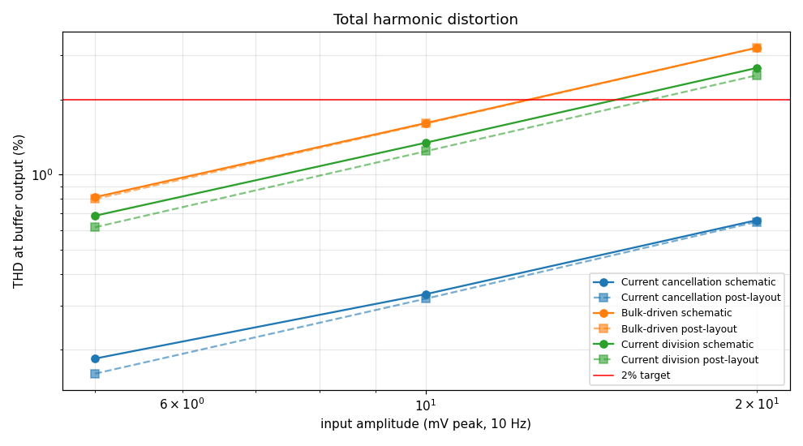
  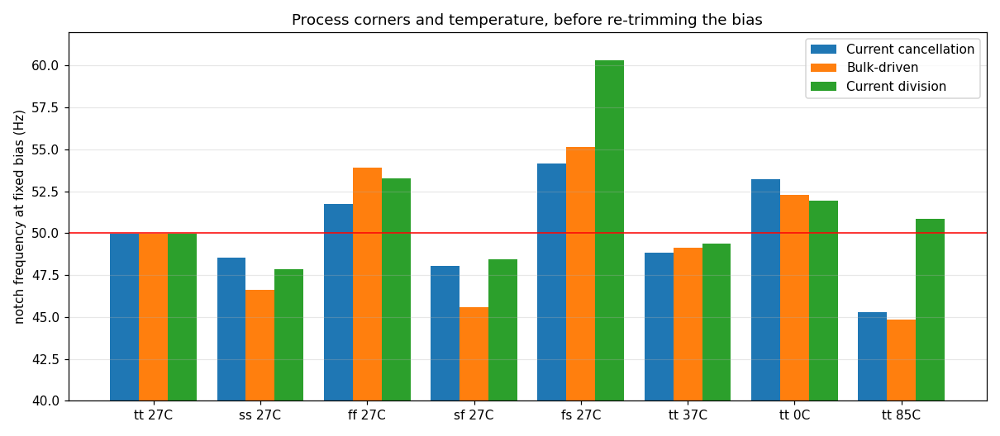
</p>

- **THD:** grows roughly linearly with input amplitude. Layout changes it by less than 0.1 percentage point. The bulk-driven filter has the highest THD despite the widest OTA linear range, so filter-level distortion is **not** predicted by the OTA's linear range alone.
- **Corners:** at a fixed bias, f<sub>0</sub> moves by between −10% and +21%, because g<sub>m</sub> ∝ 1/U<sub>T</sub> and V<sub>T</sub> shifts the current mirrors. Since f<sub>0</sub> is linear in I<sub>B</sub>, a single bias trim brings it back to the target.

<p align="center">
  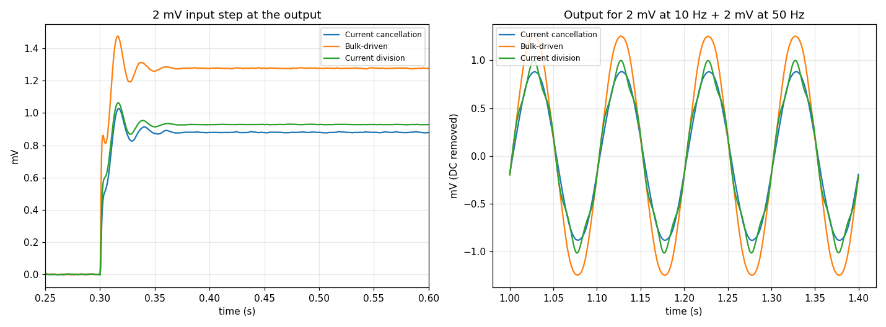
  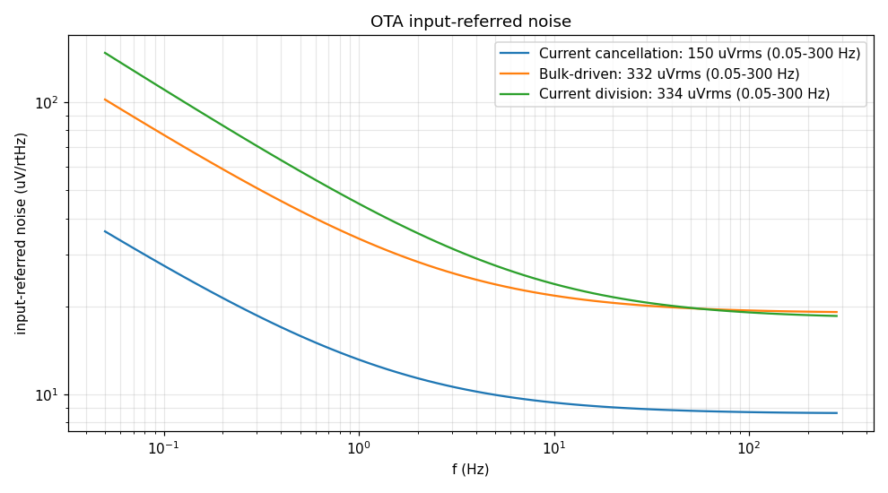
  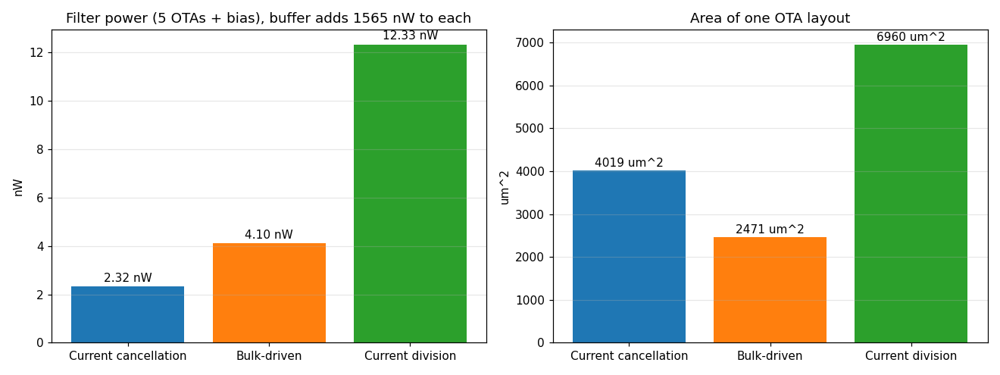
</p>

### Filter-level summary (schematic / post-layout)

| Metric | Current cancellation | Bulk-driven | Current division |
|---|---|---|---|
| Depth at 50 Hz (dB) | **43.1 / 41.7** | 38.2 / 34.3 | 22.5 / 21.0 |
| Depth at 60 Hz (dB) | **41.6 / 40.6** | 38.1 / 34.3 | 25.1 / 23.4 |
| Pass-band gain at 10 Hz (dB) | −7.06 | −4.00 | −6.59 |
| Monte Carlo yield (%) | 93 / 94 | **98 / 100** | 47 / 33 |
| Monte Carlo σ(f<sub>0</sub>) (Hz) | **1.78 / 1.95** | 3.15 / 2.38 | 10.1 / 7.4 |
| THD at 5 mV (%) | **0.18 / 0.16** | 0.81 / 0.80 | 0.69 / 0.62 |
| f<sub>0</sub> over corners (Hz) | 45.3–54.2 | 44.9–55.1 | 47.9–60.3 |
| Settling time (ms) | 44 | 41 | 41 |
| Group delay at 10 Hz (ms) | 3.64 | 2.74 | 3.05 |
| Filter power, five OTAs (nW) | **2.32** | 4.10 | 12.33 |
| Bias for 50 / 60 Hz (nA) | 0.210 / 0.253 | 0.338 / 0.413 | 0.090 / 0.111 |
| OTA area (µm²) | 4019 | **2471** | 6960 |

The filter power excludes the 1.57 µW measurement buffer.

---

## Comparison with earlier work

| Parameter | Aqueel & Ansari, TENCON 2017 [10] | Sinha et al., ICPACE 2015 [9] | Ansari et al., ICEEE 2017 [11] | **This work\*** |
|---|---|---|---|---|
| Technology | 180 nm | 22 nm | 32 nm | **130 nm (SKY130)** |
| Supply (V) | ±0.9 | ±0.95 | ±0.15 | ±0.9 |
| OTA style | Current division | Current cancellation | Bulk-driven | **All three** |
| Filter order | 6 | 3 | 6 | 3 |
| g<sub>m</sub> (nA/V) | 1.36 | 1.07–2.11 | 0.065 | 1.28–1.54 |
| Depth at 50 Hz (dB) | 28 | 20 | 17 | **43.1 / 38.2 / 22.5** |
| Power | — | 11.3 nW† | 18.8 pW | 2.3 / 4.1 / 12.3 nW |
| Layout, PEX, Monte Carlo | No | No | No | **Yes** |
| Open-source PDK | No | No | No | **Yes** |

\* Values are given for current cancellation / bulk-driven / current division. † Power of the whole front-end.

---

## Design lessons

1. **Notch depth tracks the OTA's open-loop gain.** This is a simple first-order design rule for any gyrator-based OTA-C notch.
2. **Choose current cancellation** when notch depth, distortion and power matter most.
3. **Choose bulk-driven** when robustness, linear range and area matter most.
4. **Avoid current division at sub-nA currents.** The same division ratio that lowers g<sub>m</sub> also lowers the gain and leaves the mismatch of the dumped current undivided.
5. **Equal-element sixth-order canonical notches are unstable** when tuned by a single current. Use a ladder derived from a passive LC prototype instead.
6. **At these current levels, simulation settings matter.** With ngspice's default gmin of 1 pS, the simulator's own leakage current is comparable to the signal.

---

## Repository layout

```
vlsi_analog/
├── notch_ota_current_cancellation/   # OTA style 1
│   ├── schematics/      ota_cc.sch / .sym
│   ├── tb/              notch testbench (.sch), schematic and post-layout netlists
│   ├── layout/          Magic .mag/.gds, layout Tcl script, LVS report, PEX netlist
│   ├── simulations/     Monte Carlo JSON, tuned bias, AC/transient data
│   ├── screenshots/     schematics, responses, Monte Carlo, corners, THD, layout
│   └── report/          full design report (PDF)
├── notch_ota_bulk_driven/            # OTA style 2 (same structure)
├── notch_ota_current_division/       # OTA style 3 (same structure)
├── opamp_buffer/                     # class-AB output buffer
├── comparison/                       # overlay plots, summary.json, comparison report (PDF)
├── paper/                            # IEEE-format conference paper (.docx/.pdf) + figures
├── cmos/                             # inverter warm-up (schematic → layout → post-layout)
└── xschemrc
```

---

## Reproducing the results

### Tools

| Tool | Purpose |
|---|---|
| [SkyWater SKY130 PDK](https://github.com/google/skywater-pdk) (`sky130A`) | Process models and design rules |
| [Xschem](https://xschem.sourceforge.io) | Schematic capture and netlisting |
| [ngspice](https://ngspice.sourceforge.io) | Simulation |
| [Magic](http://opencircuitdesign.com/magic) | Layout, DRC and parasitic extraction |
| [Netgen](http://opencircuitdesign.com/netgen) | LVS |

The design was built under WSL2 (Ubuntu).

### Steps

1. **Set the PDK path.** The testbench netlists point at the PDK with an absolute path. Edit the `.lib` line to match your installation:

   ```spice
   .lib /path/to/pdks/sky130A/libs.tech/ngspice/sky130.lib.spice tt
   ```

2. **Run a schematic-level simulation**, for example for the current-cancellation filter:

   ```bash
   cd notch_ota_current_cancellation/tb
   ngspice tb_ota_cc_notch.spice
   ```

3. **Run the post-layout simulation.** This testbench uses the extracted OTA netlist:

   ```bash
   ngspice tb_ota_cc_notch_pex.spice
   ```

4. **Open the schematics** in Xschem:

   ```bash
   xschem -b notch_ota_current_cancellation/tb/tb_ota_cc_notch.sch
   ```

5. **Open the layout** in Magic:

   ```bash
   cd notch_ota_current_cancellation/layout
   magic -T sky130A ota_cc.mag
   ```

The bias currents used for tuning are stored in `simulations/tuned_ota_*.txt` (50 Hz and 60 Hz values).

---

## References

1. Y. Li, C. C. Y. Poon, Y.-T. Zhang, "Analog integrated circuits design for processing physiological signals," *IEEE Rev. Biomed. Eng.*, vol. 3, pp. 93–105, 2010.
2. S. A. Mahmoud, A. Bamakhramah, S. A. Al-Tunaiji, "Six order cascaded power line notch filter for ECG detection systems with noise shaping," *CSSP*, vol. 33, no. 8, pp. 2385–2400, 2014.
3. J. Silva-Martínez, J. Salcedo-Suñer, "IC voltage to current transducers with very small transconductance," *AICSP*, vol. 13, no. 3, pp. 285–293, 1997.
4. S. Solis-Bustos et al., "A 60-dB dynamic-range CMOS sixth-order 2.4-Hz low-pass filter for medical applications," *IEEE TCAS-II*, vol. 47, no. 12, pp. 1391–1398, 2000.
5. P. Garde, "Transconductance cancellation for operational amplifiers," *IEEE JSSC*, vol. 12, no. 3, pp. 310–311, 1977.
6. B. J. Blalock, P. E. Allen, G. A. Rincón-Mora, "Designing 1-V op amps using standard digital CMOS technology," *IEEE TCAS-II*, vol. 45, no. 7, pp. 769–780, 1998.
7. E. Vittoz, J. Fellrath, "CMOS analog integrated circuits based on weak inversion operation," *IEEE JSSC*, vol. 12, no. 3, pp. 224–231, 1977.
8. F. Silveira, D. Flandre, P. G. A. Jespers, "A g<sub>m</sub>/I<sub>D</sub> based methodology for the design of CMOS analog circuits…," *IEEE JSSC*, vol. 31, no. 9, pp. 1314–1319, 1996.
9. R. Sinha, S. Khot, M. S. Ansari, "A 22nm ±0.95V CMOS OTA-C front-end with 50/60 Hz notch for biomedical signal acquisition," *ICPACE*, 2015, pp. 295–299.
10. A. Aqueel, M. S. Ansari, "Subthreshold CMOS low-transconductance OTA for powerline interference elimination notch," *IEEE TENCON*, 2017, pp. 510–515.
11. M. S. Ansari, R. Sinha, S. Khot, "Ultra-low power 50/60 Hz notch filter for biomedical signal acquisition using 32nm ±0.15V bulk-driven subthreshold CMOS OTAs," *ICEEE*, 2017, pp. 309–313.
12. B. Şekerkıran, "A compact rail-to-rail output stage for CMOS operational amplifiers," *IEEE JSSC*, vol. 34, no. 1, pp. 107–110, 1999.
13. M. J. M. Pelgrom, A. C. J. Duinmaijer, A. P. G. Welbers, "Matching properties of MOS transistors," *IEEE JSSC*, vol. 24, no. 5, pp. 1433–1439, 1989.

The full write-up is in [`paper/notch_ota_comparison_ieee_paper.pdf`](paper/notch_ota_comparison_ieee_paper.pdf). Detailed design reports for each OTA are in each folder's `report/` directory.
